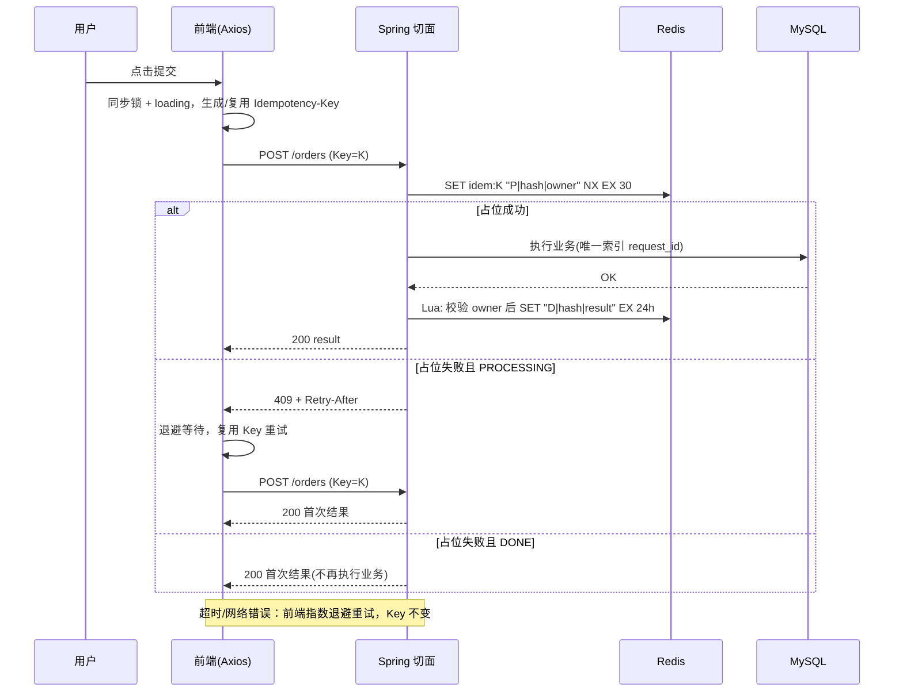

# API 幂等性完整设计方案（Spring Boot + Redis + Vue/Axios）

> 核心公式：**幂等 = 唯一标识 + 原子判重 + 结果可复用 + 数据库兜底 + 重试复用同一个 Key**

---

## 1. 背景与目标

### 1.1 重复请求从哪来

| 来源 | 说明 |
|---|---|
| 用户操作 | 连点按钮、回车重复触发、刷新/后退后重提 |
| 客户端重试 | 超时自动重试、Axios 拦截器重试 |
| 中间层重试 | 网关、Feign、Nginx `proxy_next_upstream` |
| 消息系统 | Kafka rebalance 后重复消费、MQ at-least-once |
| 第三方回调 | 支付/短信回调多次通知 |

### 1.2 哪些接口需要设计幂等

- **天然幂等**：GET、PUT（全量覆盖）、DELETE
- **需要设计**：POST 创建类（下单、支付、发券）、增量更新（`balance = balance - x`）

### 1.3 设计目标

1. 同一业务意图无论请求多少次，**副作用只发生一次**
2. 重复请求返回**与首次一致的结果**
3. 高并发下判重是**原子**的，无竞态
4. Redis 故障/过期时**数据不出错**（DB 兜底）
5. 网络异常可以**安全自动重试**

---

## 2. 整体架构

```
┌──────────────── 前端 ────────────────┐   ┌──────────────── 后端 ────────────────┐
│ ① 同步锁 + 按钮 loading               │   │ ③ Redis SET NX EX 原子占位            │
│ ② Idempotency-Key 管理（同意图复用）   │ → │    - PROCESSING → 409 + Retry-After  │
│    Axios 重试拦截器（指数退避+同 Key） │   │    - DONE → 直接返回首次结果          │
└───────────────────────────────────────┘   │ ④ 业务执行                           │
                                            │ ⑤ DB 唯一索引 + 状态机（最终兜底）    │
                                            └──────────────────────────────────────┘
```

三层防线：**前端减少请求 → Redis 快速拦截 → 数据库最终兜底**。前端不能作为安全保障（可被绕过），Redis 也不能作为唯一保障（key 过期、主从切换会丢）。

### 2.1 时序图



---

## 3. 后端实现

### 3.1 依赖

```xml
<dependency>
  <groupId>org.springframework.boot</groupId>
  <artifactId>spring-boot-starter-data-redis</artifactId>
</dependency>
<dependency>
  <groupId>org.springframework.boot</groupId>
  <artifactId>spring-boot-starter-aop</artifactId>
</dependency>
```

### 3.2 Redis 中的数据结构

| 状态 | Value 格式 | TTL |
|---|---|---|
| 处理中 | `P\|{请求体hash}\|{ownerUUID}` | `processingTtl`（默认 30s，需大于业务 P99 耗时） |
| 已完成 | `D\|{请求体hash}\|{结果JSON}` | `resultTtl`（默认 24h） |

- **请求体 hash**：同一个 Key 却携带不同参数，说明客户端误用，返回 422，避免"拿 A 请求的结果响应 B 请求"。
- **ownerUUID**：保证只有占位者本人才能提交结果/释放，避免占位过期后误删他人的 key。

### 3.3 注解

```java
@Target(ElementType.METHOD)
@Retention(RetentionPolicy.RUNTIME)
public @interface Idempotent {
    /** 处理中占位超时（秒），应大于业务最大耗时 */
    long processingTtl() default 30;
    /** 结果缓存时间（秒） */
    long resultTtl() default 24 * 3600;
}
```

### 3.4 异常定义

```java
public class IdempotencyException extends RuntimeException {
    private final int status;
    private final long retryAfterSeconds;
    public IdempotencyException(int status, String msg, long retryAfterSeconds) {
        super(msg);
        this.status = status;
        this.retryAfterSeconds = retryAfterSeconds;
    }
    public int getStatus() { return status; }
    public long getRetryAfterSeconds() { return retryAfterSeconds; }
}

@RestControllerAdvice
public class IdempotencyExceptionHandler {
    @ExceptionHandler(IdempotencyException.class)
    public ResponseEntity<Map<String, Object>> handle(IdempotencyException e) {
        ResponseEntity.BodyBuilder b = ResponseEntity.status(e.getStatus());
        if (e.getRetryAfterSeconds() > 0) {
            b.header("Retry-After", String.valueOf(e.getRetryAfterSeconds()));
        }
        return b.body(Map.of("code", e.getStatus(), "message", e.getMessage()));
    }
}
```

### 3.5 切面（核心）

```java
@Slf4j
@Aspect
@Component
@RequiredArgsConstructor
public class IdempotentAspect {

    private static final String PREFIX = "idem:";

    /** 仅当 value 与期望完全一致（即仍是自己占的位）才写入最终结果 */
    private static final RedisScript<Long> FINISH = new DefaultRedisScript<>(
        "if redis.call('get', KEYS[1]) == ARGV[1] then " +
        "  redis.call('set', KEYS[1], ARGV[2], 'EX', tonumber(ARGV[3])) return 1 " +
        "else return 0 end", Long.class);

    /** 仅当仍是自己占的位才删除 */
    private static final RedisScript<Long> RELEASE = new DefaultRedisScript<>(
        "if redis.call('get', KEYS[1]) == ARGV[1] then return redis.call('del', KEYS[1]) " +
        "else return 0 end", Long.class);

    private final StringRedisTemplate redis;
    private final ObjectMapper objectMapper;

    @Around("@annotation(idem)")
    public Object around(ProceedingJoinPoint pjp, Idempotent idem) throws Throwable {
        HttpServletRequest req =
            ((ServletRequestAttributes) RequestContextHolder.currentRequestAttributes()).getRequest();

        String idemKey = req.getHeader("Idempotency-Key");
        if (idemKey == null || idemKey.isBlank() || idemKey.length() > 64) {
            throw new IdempotencyException(400, "缺少或非法的 Idempotency-Key 请求头", 0);
        }

        // key 隔离：用户 + 接口 + 幂等键，避免跨用户/跨接口碰撞
        String key = PREFIX + currentUserId() + ":" + req.getMethod() + ":" + req.getRequestURI() + ":" + idemKey;

        String hash = sha256(objectMapper.writeValueAsString(pjp.getArgs()));
        String owner = UUID.randomUUID().toString();
        String processingVal = "P|" + hash + "|" + owner;

        Boolean acquired = redis.opsForValue()
            .setIfAbsent(key, processingVal, idem.processingTtl(), TimeUnit.SECONDS);

        if (Boolean.TRUE.equals(acquired)) {
            return executeAndRecord(pjp, idem, key, processingVal, hash);
        }
        return handleDuplicate(pjp, key, hash);
    }

    private Object executeAndRecord(ProceedingJoinPoint pjp, Idempotent idem,
                                    String key, String processingVal, String hash) throws Throwable {
        Object result;
        try {
            result = pjp.proceed();
        } catch (Throwable e) {
            // 业务失败：释放占位，允许客户端用同一个 Key 重试
            safeRelease(key, processingVal);
            throw e;
        }
        // 业务已成功。此处 Redis 异常不能影响业务结果，也不能删 key，
        // 重复执行的风险由 DB 唯一索引/状态机兜底
        try {
            String doneVal = "D|" + hash + "|" + objectMapper.writeValueAsString(result);
            redis.execute(FINISH, List.of(key), processingVal, doneVal,
                          String.valueOf(idem.resultTtl()));
        } catch (Exception e) {
            log.warn("幂等结果写入失败，依赖 DB 兜底, key={}", key, e);
        }
        return result;
    }

    private Object handleDuplicate(ProceedingJoinPoint pjp, String key, String hash) throws Throwable {
        String val = redis.opsForValue().get(key);
        if (val == null) {
            // 恰好在读取前过期/被释放，让客户端稍后用同一 Key 重试
            throw new IdempotencyException(409, "请求状态变更，请重试", 1);
        }
        String[] parts = val.split("\\|", 3);   // [状态, hash, owner|结果]
        if (!parts[1].equals(hash)) {
            throw new IdempotencyException(422, "同一 Idempotency-Key 不能用于不同的请求内容", 0);
        }
        if ("P".equals(parts[0])) {
            throw new IdempotencyException(409, "请求正在处理中，请稍后", 1);
        }
        // DONE：直接返回首次结果，保证响应一致
        Type returnType = ((MethodSignature) pjp.getSignature()).getMethod().getGenericReturnType();
        return objectMapper.readValue(parts[2], objectMapper.constructType(returnType));
    }

    private void safeRelease(String key, String processingVal) {
        try {
            redis.execute(RELEASE, List.of(key), processingVal);
        } catch (Exception e) {
            log.warn("释放幂等占位失败，将在 TTL 后自动过期, key={}", key, e);
        }
    }

    private static String sha256(String s) {
        try {
            byte[] d = MessageDigest.getInstance("SHA-256").digest(s.getBytes(StandardCharsets.UTF_8));
            return HexFormat.of().formatHex(d);
        } catch (NoSuchAlgorithmException e) {
            throw new IllegalStateException(e);
        }
    }

    private String currentUserId() { /* 从 SecurityContext / Token 解析 */ return "u1"; }
}
```

> **关键点**
> - 占位必须用 `SET key val NX EX ttl` **一条命令**完成，不能拆成 `setnx` + `expire`（中间崩溃会留下永不过期的 key）。
> - 完成/释放使用 **Lua 做比较后再写/删**，保证原子且不误操作他人的 key。
> - 业务成功后写 Redis 失败**不能删 key、也不能抛异常**，否则用户拿到错误而订单已创建。

### 3.6 使用

```java
@PostMapping("/orders")
@Idempotent(processingTtl = 30)
public Result<OrderVO> createOrder(@RequestBody CreateOrderReq req) {
    return Result.ok(orderService.create(req));
}
```

### 3.7 数据库兜底（必须有）

**唯一索引**：

```sql
CREATE TABLE t_order (
    id          BIGINT PRIMARY KEY,
    request_id  VARCHAR(64) NOT NULL COMMENT '客户端幂等键/业务唯一号',
    user_id     BIGINT NOT NULL,
    status      VARCHAR(16) NOT NULL,
    created_at  DATETIME NOT NULL,
    UNIQUE KEY uk_user_request (user_id, request_id)
);
```

```java
@Transactional
public OrderVO create(CreateOrderReq req) {
    Order order = build(req);
    try {
        orderMapper.insert(order);
    } catch (DuplicateKeyException e) {
        // Redis 层漏过的重复请求，在这里被拦截，返回已有订单
        return toVO(orderMapper.selectByUserAndRequestId(order.getUserId(), order.getRequestId()));
    }
    return toVO(order);
}
```

> 因此 Controller 需要把 `Idempotency-Key` 透传到业务层作为 `request_id`（可通过 `ThreadLocal`/参数传递）。

**状态机 / 条件更新**（更新类操作）：

```sql
-- 支付回调：只有"待支付"才能变"已支付"，重复回调影响行数为 0
UPDATE t_order SET status = 'PAID' WHERE id = ? AND status = 'UNPAID';

-- 扣库存：带条件，同时防重复与超卖
UPDATE t_stock SET num = num - ? WHERE sku_id = ? AND num >= ?;
```

```java
int rows = orderMapper.markPaid(orderId);
if (rows == 0) { /* 已处理过，直接返回成功 */ }
```

### 3.7 备选：两阶段 Token（防表单重复提交）

适合"先进页面、再提交"的场景：`GET /token` → 服务端 `SET token 1 EX 300`；提交时用 Lua 原子"校验并删除"。

```java
private static final RedisScript<Long> CONSUME = new DefaultRedisScript<>(
    "if redis.call('get',KEYS[1]) then return redis.call('del',KEYS[1]) else return 0 end", Long.class);

boolean ok = Long.valueOf(1).equals(redis.execute(CONSUME, List.of(tokenKey)));
```

不能先 `GET` 再 `DEL`（并发下两个请求都能 GET 到）。缺点：token 删除后业务失败无法重试，且无法返回上次结果，所以通用场景首选 3.5 的方案。

---

## 4. 前端实现（Vue 3 + Axios）

### 4.1 防重复点击：同步锁 + loading

`disabled` 依赖状态渲染，极速双击可能在置灰前触发两次，所以需要**同步的普通变量锁**。锁要加在**提交函数**上，而不是只加在按钮上（回车键会绕过按钮的 `disabled`）。

```ts
// useSubmit.ts
import { ref } from 'vue'

export function useSubmit<T>(fn: (...args: any[]) => Promise<T>) {
  const loading = ref(false)
  let locked = false                       // 同步锁

  const run = async (...args: any[]): Promise<T | undefined> => {
    if (locked) return
    locked = true
    loading.value = true
    try {
      return await fn(...args)
    } finally {
      locked = false
      loading.value = false
    }
  }
  return { loading, run }
}
```

### 4.2 幂等键管理

规则：**一个业务意图对应一个 Key；重试复用；成功或明确业务失败后才换新。**

```ts
// idempotency.ts
const store = new Map<string, string>()    // scene -> key

export const getIdemKey = (scene: string): string => {
  let k = store.get(scene)
  if (!k) {
    k = crypto.randomUUID()
    store.set(scene, k)
  }
  return k
}
export const resetIdemKey = (scene: string) => { store.delete(scene) }
```

| 场景 | Key 处理 |
|---|---|
| 首次提交 | 生成新 UUID |
| 超时 / 网络错误 / 5xx / 429 | **复用** |
| 409「处理中」 | **复用**，退避后重试 |
| 业务成功 | 丢弃，下次新 Key |
| 400/401/403/404/422 等明确业务失败 | 丢弃（用户修改后重新生成） |
| 表单内容发生变化 | 重新生成（否则会 422） |

> 常见错误：**每次点击或每次重试都生成新 Key**，等于没有幂等。

### 4.3 Axios 实例 + 自动重试拦截器（指数退避 + 同一 Key）

**设计要点**

1. 通过请求配置 `idempotent: true` 声明接口可安全重试（**只有携带幂等键的请求才允许自动重试**，普通 POST 重试可能重复执行）。
2. Key 在**请求拦截器**里生成一次并写入 `config.headers`；重试时复用同一个 `config`，因此 Key 不变。
3. 可重试条件：网络错误、超时、`408/425/429/500/502/503/504`、以及 `409`（服务端处理中）。
4. 退避公式：`delay = min(maxDelay, baseDelay × 2^n)`，再加**抖动**（防止大量客户端同一时刻重试造成惊群）；若响应带 `Retry-After`，以服务端为准。
5. 请求被主动取消（`AbortController`）时不重试。

```ts
// http.ts
import axios, { AxiosError, AxiosInstance, InternalAxiosRequestConfig } from 'axios'
import { getIdemKey, resetIdemKey } from './idempotency'

export interface RetryOptions {
  retries?: number       // 最大重试次数，默认 3
  baseDelay?: number     // 基础退避(ms)，默认 500
  maxDelay?: number      // 最大退避(ms)，默认 8000
}

declare module 'axios' {
  interface AxiosRequestConfig {
    /** 声明为幂等请求：自动携带 Idempotency-Key，并允许自动重试 */
    idempotent?: boolean
    /** 场景名：同一场景跨多次用户点击复用同一个 Key；不传则每次调用新生成 */
    idemScene?: string
    retry?: RetryOptions
    __retryCount?: number
  }
}

const IDEM_HEADER = 'Idempotency-Key'
const RETRY_STATUS = new Set([408, 425, 429, 500, 502, 503, 504])
const DEFAULTS: Required<RetryOptions> = { retries: 3, baseDelay: 500, maxDelay: 8000 }

const sleep = (ms: number) => new Promise<void>(r => setTimeout(r, ms))

/** 指数退避 + 抖动（equal jitter：一半固定，一半随机） */
function backoff(attempt: number, base: number, max: number): number {
  const exp = Math.min(max, base * 2 ** attempt)
  return exp / 2 + Math.random() * (exp / 2)
}

/** 解析 Retry-After（秒数或 HTTP 日期），返回毫秒；无效返回 null */
function parseRetryAfter(v?: string | null): number | null {
  if (!v) return null
  const sec = Number(v)
  if (!Number.isNaN(sec)) return Math.max(0, sec * 1000)
  const t = Date.parse(v)
  return Number.isNaN(t) ? null : Math.max(0, t - Date.now())
}

function isRetryable(err: AxiosError): boolean {
  if (axios.isCancel(err)) return false
  if (err.config?.signal?.aborted) return false
  if (!err.response) return true                        // 网络错误 / 超时 / 连接被重置
  const s = err.response.status
  return RETRY_STATUS.has(s) || s === 409               // 409 = 服务端处理中，等待后复用 Key 查询结果
}

/** 明确的业务失败：4xx 且不是 409/429/408/425，下次应换新 Key */
function isBusinessFailure(err: AxiosError): boolean {
  const s = err.response?.status
  return !!s && s >= 400 && s < 500 && !RETRY_STATUS.has(s) && s !== 409
}

export const http: AxiosInstance = axios.create({ baseURL: '/api', timeout: 10000 })

// ① 请求拦截器：为幂等请求注入 Key（重试时 header 已存在，直接复用）
http.interceptors.request.use((config: InternalAxiosRequestConfig) => {
  if (config.idempotent && !config.headers.has(IDEM_HEADER)) {
    const key = config.idemScene ? getIdemKey(config.idemScene) : crypto.randomUUID()
    config.headers.set(IDEM_HEADER, key)
  }
  return config
})

// ② 响应拦截器：成功换新 Key；失败按规则退避重试
http.interceptors.response.use(
  (res) => {
    const { idempotent, idemScene } = res.config
    if (idempotent && idemScene) resetIdemKey(idemScene)   // 业务成功：下次提交使用新 Key
    return res
  },
  async (error: AxiosError) => {
    const config = error.config
    if (!config || !config.idempotent) throw error         // 非幂等请求绝不自动重试

    const opt = { ...DEFAULTS, ...config.retry }
    const attempt = config.__retryCount ?? 0

    if (attempt >= opt.retries || !isRetryable(error)) {
      if (config.idemScene && isBusinessFailure(error)) resetIdemKey(config.idemScene)
      throw error                                          // 次数耗尽 / 不可重试
    }

    config.__retryCount = attempt + 1

    // 服务端指定的 Retry-After 优先，否则指数退避 + 抖动
    const serverDelay = parseRetryAfter(error.response?.headers?.['retry-after'] as string | undefined)
    const delay = serverDelay ?? backoff(attempt, opt.baseDelay, opt.maxDelay)

    await sleep(Math.min(delay, opt.maxDelay))
    if (config.signal?.aborted) throw error                // 等待期间被取消

    return http.request(config)                            // 同一个 config → 同一个 Idempotency-Key
  }
)
```

> **为什么不会丢 Key**：重试直接传入 `error.config`，其 `headers` 中已写入 `Idempotency-Key`，请求拦截器发现 header 已存在就不再生成。

### 4.4 业务 API 封装

```ts
// api/order.ts
import { http } from '@/utils/http'

export const createOrder = (form: OrderForm) =>
  http.post('/orders', form, {
    idempotent: true,
    idemScene: 'create-order',            // 用户多次点击也复用同一个 Key，直到成功/业务失败
    retry: { retries: 3, baseDelay: 500 },
    timeout: 8000,
  }).then(r => r.data)
```

> **表单内容变化时**需调用 `resetIdemKey('create-order')`，否则后端会因 hash 不一致返回 422。可在 `watch(form, ..., { deep: true })` 中处理。

### 4.5 页面使用

```vue
<template>
  <el-form @submit.prevent="run">
    <!-- ... 表单项 ... -->
    <el-button type="primary" native-type="submit" :loading="loading" :disabled="loading">
      提交订单
    </el-button>
  </el-form>
</template>

<script setup lang="ts">
import { watch } from 'vue'
import { useRouter } from 'vue-router'
import { useSubmit } from '@/composables/useSubmit'
import { resetIdemKey } from '@/utils/idempotency'
import { createOrder } from '@/api/order'

const router = useRouter()

watch(form, () => resetIdemKey('create-order'), { deep: true })   // 内容变了就是新意图

const { loading, run } = useSubmit(async () => {
  try {
    const res = await createOrder(form)
    router.replace(`/orders/${res.id}`)        // replace：避免后退回到表单再次提交
  } catch (e: any) {
    if (e.response?.status === 409) {
      ElMessage.info('订单仍在处理中，请稍后在"我的订单"中查看')
    } else if (!e.response) {
      ElMessage.error('网络异常，请检查网络后重试（不会重复下单）')
    } else {
      ElMessage.error(e.response.data?.message ?? '提交失败')
    }
  }
})
</script>
```

### 4.6 React 版 useSubmit（简版）

```tsx
function useSubmit<T>(fn: () => Promise<T>) {
  const [loading, setLoading] = useState(false)
  const lockedRef = useRef(false)                 // 用 ref 做同步锁

  const run = useCallback(async () => {
    if (lockedRef.current) return
    lockedRef.current = true
    setLoading(true)
    try { return await fn() }
    finally { lockedRef.current = false; setLoading(false) }
  }, [fn])

  return { loading, run }
}
```

### 4.7 其他前端细节

- **多标签页**：前端锁对跨标签页无效，可用 `BroadcastChannel` 增强；最终仍以后端为准。
- **防抖**：提交类操作不建议只靠防抖（窗口是猜的）；轻量操作（点赞、搜索）可用 `debounce(fn, 1000, { leading: true, trailing: false })`。
- **整页遮罩**：弹窗/整页提交时加全屏 loading，防止用户操作其他位置。
- **自动重试期间的用户反馈**：重试可能持续数秒，保持按钮 loading，并可显示"网络不稳定，正在重试…"。

---

## 5. 前后端协作规则（重试与幂等）

| 前端遇到 | 含义 | 前端行为 | 后端保证 |
|---|---|---|---|
| 超时 / 网络错误 | 不确定请求是否已执行 | 退避重试，**同一 Key** | 已执行 → 返回首次结果；未执行 → 正常执行 |
| 409 + Retry-After | 首次请求仍在处理 | 按 Retry-After 等待后重试，同一 Key | 处理完成后返回首次结果 |
| 429 / 503 | 限流/过载 | 退避重试，同一 Key | 无副作用 |
| 500 / 502 / 504 | 服务异常 | 退避重试，同一 Key（有上限） | 业务失败已释放占位，可重新执行 |
| 422 | Key 与请求内容不匹配 | **不重试**，换新 Key | 拒绝执行 |
| 400/401/403/404 | 业务/参数/权限错误 | **不重试**，换新 Key | 已释放占位 |
| 重试次数耗尽 | — | 提示用户；Key **保留**，用户再点仍是同一意图 | — |

---

## 6. 高并发下的关键问题

| 问题 | 解决办法 |
|---|---|
| `SETNX` 与 `EXPIRE` 分开导致死锁 key | 使用 `SET NX EX` 单条原子命令 |
| 业务耗时超过 `processingTtl`，占位过期后被重复执行 | TTL 设为大于业务 P99；超长任务用 Redisson 看门狗续期；**DB 唯一索引兜底** |
| 业务成功、写结果前进程宕机 | 占位过期后重试会再次执行 → **必须靠 DB 唯一索引/状态机兜底** |
| 误删/误覆盖他人的 key | value 携带 owner，用 Lua 比较后再操作（3.5 已实现） |
| Redis 主从切换丢 key | 资金类业务以 DB 为准，Redis 只做加速 |
| 同一 Key 不同参数 | 请求体 hash 校验，返回 422 |
| 结果缓存过大 | 只缓存业务主键（订单号），重复请求时再查库组装 |
| 重试风暴 | 指数退避 + 抖动 + 次数上限；服务端限流并返回 `Retry-After` |
| 热点 key | Key 含用户 ID 与随机 UUID，天然分散 |
| 集群 Lua 多 key | 脚本只操作单个 key，不涉及跨 slot 问题 |

---

## 7. 不同场景选型

| 场景 | 方案 |
|---|---|
| 下单 / 创建资源 | 本文主方案（Key + Redis 占位）+ DB 唯一索引 |
| 支付回调 / 第三方通知 | 以第三方流水号为幂等键，DB 唯一索引 + 状态机；Redis 可省略 |
| 表单重复提交 | 前端同步锁 + 主方案；或 Token + Lua（3.7） |
| 扣减库存 / 余额 | 条件更新 SQL（`WHERE num >= ?`） |
| MQ / Kafka 消费 | 消息 ID 或业务主键去重：`消费记录表` 唯一索引 + 与业务同一本地事务 |

**Kafka 消费端幂等示例**：

```java
@Transactional
public void onMessage(ConsumerRecord<String, String> record) {
    String msgId = record.headers().lastHeader("msgId") != null
        ? new String(record.headers().lastHeader("msgId").value())
        : record.topic() + "-" + record.partition() + "-" + record.offset();
    try {
        consumeLogMapper.insert(new ConsumeLog(msgId));   // msg_id 唯一索引
    } catch (DuplicateKeyException e) {
        return;                                           // 已消费，直接跳过
    }
    handle(record);                                       // 与去重记录在同一事务中
}
```

---

## 8. 测试

### 8.1 后端并发测试（同一 Key 100 并发，业务只执行一次）

```java
@SpringBootTest
@AutoConfigureMockMvc
class IdempotentConcurrencyTest {

    @Autowired MockMvc mvc;
    @Autowired OrderMapper orderMapper;

    @Test
    void sameKey_concurrent_onlyOneOrder() throws Exception {
        String key = UUID.randomUUID().toString();
        String body = "{\"skuId\":1,\"num\":1}";
        int n = 100;
        ExecutorService pool = Executors.newFixedThreadPool(n);
        CountDownLatch start = new CountDownLatch(1);
        List<Future<Integer>> fs = new ArrayList<>();

        for (int i = 0; i < n; i++) {
            fs.add(pool.submit(() -> {
                start.await();
                return mvc.perform(post("/orders")
                        .header("Idempotency-Key", key)
                        .contentType(MediaType.APPLICATION_JSON).content(body))
                    .andReturn().getResponse().getStatus();
            }));
        }
        start.countDown();

        for (Future<Integer> f : fs) {
            assertThat(f.get()).isIn(200, 409);   // 只会是成功或"处理中"
        }
        assertThat(orderMapper.countByRequestId(key)).isEqualTo(1);   // 副作用只发生一次
    }

    @Test
    void sameKey_differentBody_returns422() throws Exception { /* 先 A 后 B，断言 422 */ }

    @Test
    void businessFailure_releasesKey() throws Exception { /* 首次抛异常，同 Key 再请求可重新执行 */ }
}
```

### 8.2 前端拦截器测试清单（可用 `axios-mock-adapter`）

- 连续 2 次 `ECONNABORTED` 后第 3 次成功：共发 3 次请求，**3 次 `Idempotency-Key` 完全相同**
- 返回 409 + `Retry-After: 1`：等待约 1s 后重试
- 返回 400：**不重试**，Key 被重置
- 非 `idempotent` 请求遇到超时：**不重试**
- 重试次数耗尽：抛出错误，Key 保留
- 退避间隔随次数增长且不超过 `maxDelay`
- 重试等待期间 `AbortController.abort()`：不再发出请求

---

## 9. 上线检查清单

**后端**
- [ ] 占位使用 `SET NX EX` 原子命令
- [ ] 完成/释放使用 Lua + owner 校验
- [ ] 业务表有 `(user_id, request_id)` 唯一索引
- [ ] 更新类操作使用状态机 / 条件 SQL
- [ ] 同一 Key 不同请求体返回 422
- [ ] 处理中返回 409 + `Retry-After`
- [ ] `processingTtl` 大于业务 P99 耗时
- [ ] 结果写 Redis 失败不影响业务返回

**前端**
- [ ] 提交函数同步锁 + 按钮 loading（含回车场景）
- [ ] 一次意图一个 Key，重试复用，成功/业务失败才重置
- [ ] 表单变化时重置 Key
- [ ] 仅对声明 `idempotent` 的请求自动重试
- [ ] 指数退避 + 抖动 + 次数上限，遵守 `Retry-After`
- [ ] 提交成功后 `router.replace` 跳转

**总结**

> 客户端为每个业务意图生成唯一 `Idempotency-Key`，失败重试复用它 → 服务端 `SET NX EX` 原子占位并区分"处理中/已完成" → 已完成直接返回首次结果 → 数据库唯一索引与状态机作为最终防线 → 前端用同步锁与退避重试把重复请求压到最低。