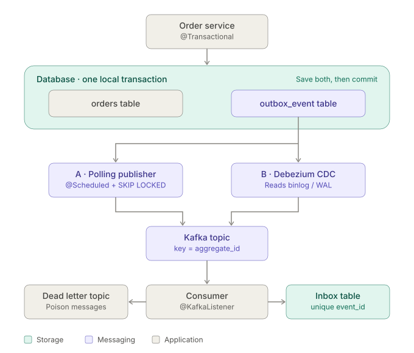

下面是架构全景图：---



事务性外箱模式 Outbox 架构:写入侧事务边界、两种投递方式、消费端幂等和死信处理。

 "Save Order → Save Outbox Event → Commit → Publisher → Kafka" 基础上做了几处扩展:

- **事务边界**:`orders` 和 `outbox_event` 放在同一个数据库容器里,同一次本地事务提交,这是整个模式的核心。
- **投递层分两条路**:A 是轮询发布,即应用内定时扫描 outbox,用 `SKIP LOCKED` 支持多实例;B 是 Debezium CDC,读 binlog 或 WAL 后路由到 Kafka。两者数据模型兼容,可以先上 A,以后再切 B。
- **Kafka key 用 `aggregate_id`**:保证同一聚合内的事件有序。
- **消费端**:用 inbox 表的 `event_id` 唯一键做幂等,并配合死信 topic 处理毒丸消息。这一层不能省,因为投递语义是 at-least-once。


# Spring Kafka 事务性外箱(Transactional Outbox)架构方案

## 1. 要解决的问题

业务里常见的"写库 + 发 Kafka"是**双写**,无法用一个事务保证原子性:

- 先提交 DB、再发 Kafka:进程在两步之间崩溃,消息丢失。
- 先发 Kafka、再提交 DB:DB 回滚后,消息已发出,产生幽灵事件。
- Spring 的 `KafkaTransactionManager` 加 `@Transactional` 只是尽力一次提交(best-effort 1PC),**不是原子的**,`ChainedTransactionManager` 也已废弃,不建议依赖。

Outbox 的思路是:**业务数据和待发消息在同一个本地 DB 事务里落库**,再由独立的 relay 异步把消息投递到 Kafka。语义是 **at-least-once**,消费端必须幂等。

## 2. 总体架构

```
┌────────────── Service ──────────────┐
│ @Transactional                       │
│  1. 写业务表 (order)                 │
│  2. 写 outbox 表 (同一事务)          │
└──────────────┬───────────────────────┘
               │ commit
          ┌────▼─────┐
          │ Database │
          └────┬─────┘
     ┌─────────┴───────────┐
     │ 方案A: 轮询 Relay    │  方案B: CDC (Debezium)
     │ (Spring Scheduler)   │  读 binlog/WAL → Kafka
     └─────────┬───────────┘
               ▼
            Kafka  ──►  Consumer(幂等:inbox 表 / 业务唯一键)
```

## 3. Outbox 表设计

```sql
CREATE TABLE outbox_event (
  id            BIGINT PRIMARY KEY AUTO_INCREMENT,   -- 递增,用于保序扫描
  event_id      VARCHAR(36)  NOT NULL UNIQUE,        -- UUID,消费端幂等键
  aggregate_type VARCHAR(64) NOT NULL,               -- 映射 topic
  aggregate_id  VARCHAR(64)  NOT NULL,               -- 作为 Kafka key,保证同聚合有序
  event_type    VARCHAR(64)  NOT NULL,
  payload       JSON         NOT NULL,
  status        TINYINT      NOT NULL DEFAULT 0,     -- 0 NEW, 1 SENT, 2 FAILED
  retry_count   INT          NOT NULL DEFAULT 0,
  created_at    DATETIME(3)  NOT NULL,
  sent_at       DATETIME(3)  NULL,
  KEY idx_status_id (status, id)
);
```

## 4. 写入侧

```java
@Service
@RequiredArgsConstructor
public class OrderService {
    private final OrderRepository orderRepo;
    private final OutboxRepository outboxRepo;
    private final ObjectMapper mapper;

    @Transactional
    public Order create(CreateOrderCmd cmd) {
        Order order = orderRepo.save(Order.from(cmd));
        outboxRepo.save(OutboxEvent.builder()
            .eventId(UUID.randomUUID().toString())
            .aggregateType("order")
            .aggregateId(order.getId().toString())
            .eventType("OrderCreated")
            .payload(mapper.valueToTree(OrderCreated.of(order)))
            .createdAt(Instant.now())
            .build());
        return order;
    }
}
```

关键点:outbox 写入必须与业务写入在**同一个数据源、同一个事务**内。

## 5. 投递侧

### 方案 A:轮询发布(Polling Publisher),依赖少,适合起步

```java
@Component
@RequiredArgsConstructor
public class OutboxRelay {
    private final OutboxRepository repo;
    private final KafkaTemplate<String, String> kafka;
    private final TransactionTemplate tx;

    @Scheduled(fixedDelay = 200)
    public void poll() {
        tx.executeWithoutResult(s -> {
            // SELECT ... WHERE status=0 ORDER BY id LIMIT 200 FOR UPDATE SKIP LOCKED
            List<OutboxEvent> batch = repo.lockNextBatch(200);
            List<CompletableFuture<?>> futures = new ArrayList<>();
            for (OutboxEvent e : batch) {
                ProducerRecord<String,String> r = new ProducerRecord<>(
                    topicOf(e), e.getAggregateId(), e.getPayload());
                r.headers().add("event-id", e.getEventId().getBytes(UTF_8));
                futures.add(kafka.send(r).whenComplete((res, ex) -> {
                    if (ex == null) e.markSent(); else e.markRetry();
                }));
            }
            futures.forEach(CompletableFuture::join); // 批内全部确认后再提交 DB
        });
    }
}
```

要点:

- `FOR UPDATE SKIP LOCKED`(MySQL 8 / PostgreSQL)允许多实例并行抢不同批次,避免重复投递和锁等待。
- 先等 Kafka 确认(`acks=all`),再提交 DB 状态。崩溃只会导致重复发送,不会丢,这正是 at-least-once。
- **保序**:多实例并行时,同一 `aggregate_id` 的事件可能被不同实例处理而乱序。解决办法:单实例加 ShedLock 选主,或按 `hash(aggregate_id) % N` 分片,每个实例只处理自己的分片。

Producer 配置:

```yaml
spring.kafka.producer:
  acks: all
  properties:
    enable.idempotence: true
    max.in.flight.requests.per.connection: 5   # 幂等开启时仍保序
    delivery.timeout.ms: 120000
```

### 方案 B:CDC + Debezium Outbox Event Router,吞吐高、延迟低、无轮询压力

- Debezium 读 binlog/WAL,用 `EventRouter` SMT 把 outbox 行路由到对应 topic,`aggregate_id` 作 key。
- 应用侧**只写表,不需要 relay 代码**;outbox 行写入后即可删除(Debezium 读的是日志,不依赖行存在)。
- 代价:多维护 Kafka Connect 与 Debezium,需要处理 connector 故障和 snapshot 问题。

**选型建议**:吞吐在几千 TPS 以内、希望运维简单,选 A;吞吐大、对延迟敏感、已有 Kafka Connect,选 B。两者在数据模型上兼容,可以先 A 后 B 平滑演进。

## 6. 消费端幂等(必须做)

```java
@KafkaListener(topics = "order")
@Transactional
public void on(ConsumerRecord<String,String> rec) {
    String eventId = header(rec, "event-id");
    if (!inboxRepo.insertIgnore(eventId)) return;   // 唯一键冲突 → 已处理
    handle(rec.value());
}
```

用 `inbox(event_id PK)` 表与业务处理放在同一事务里,或者直接依赖业务天然幂等(upsert、状态机)。同时配置:

```yaml
spring.kafka.consumer:
  enable-auto-commit: false
  isolation-level: read_committed   # 仅当上游还用了 Kafka 事务时才有意义
spring.kafka.listener.ack-mode: record
```

并配置 `DefaultErrorHandler` + `DeadLetterPublishingRecoverer` 处理毒丸消息,避免阻塞分区。

## 7. 运维与常见坑

| 问题 | 对策 |
|---|---|
| outbox 表无限增长 | 定时清理(如保留 3–7 天的 SENT 数据),按 `created_at` 分批删,或做分区表 |
| 轮询扫描变慢 | 索引 `(status, id)`;只扫 NEW,已发送及时转移或删除 |
| 毒丸事件反复重试 | `retry_count` 超阈值置 FAILED,告警并人工介入 |
| 事件乱序 | 以 `aggregate_id` 做 key;relay 保证同聚合串行 |
| 大 payload | 控制在 1MB 以内,大对象放存储,事件只带引用 |
| 事件结构演进 | payload 带 `schema_version`,或使用 Schema Registry(Avro/Protobuf) |
| 监控 | 指标:未发送积压量、最老 NEW 事件年龄(延迟)、失败数、发送耗时 |

## 8. 方案取舍小结

- **保证**:本地事务原子性 + at-least-once 投递 + 消费端幂等,组合起来达到**业务上的恰好一次效果**。
- **不保证**:全局严格有序(只保证同聚合有序)、零延迟(轮询有 100–500ms 级延迟)。
- 如果 relay 与消费都在 Kafka 内闭环(consume-transform-produce),可以用 Kafka 事务(`transactional.id` + `read_committed`)。但那解决的是 Kafka 内部的原子性,**不能替代 outbox 解决 DB 与 Kafka 的双写问题**。

如果需要,我可以把它整理成一份可以评审的架构文档,或者按你们的数据库(MySQL/PostgreSQL)和部署方式(多副本 K8s)细化 relay 的分片与选主方案。